# Frontend

## Overview

The Frontend is the Angular-based client application for the Boardgame Market distributed system.

It is responsible for:

- Providing the primary user interface for the platform
- Supporting end-to-end marketplace workflows
- Communicating with the Market Gateway
- Managing client-side state and interaction flows

The frontend is designed primarily as a consumer of the Market Gateway API and does not communicate directly with internal microservices.

> NOTE:
> This repository is part of a snapshot-style public monorepo used for navigation and demonstration purposes.
> The primary development workflow for this service uses a separate private Azure DevOps repository.

---

## Responsibilities

This application is responsible for the following:

- User interaction workflows
- Listing and marketplace presentation
- Client-side form handling and validation
- Authentication flow integration
- Aggregated data presentation

It does NOT:

- Communicate directly with backend microservices
- Contain backend business logic
- Persist authoritative business data

---

## Architecture

### Internal Structure

- Feature-based Angular components
- Shared UI and utility components
- Services for API communication
- Reactive forms and validation logic

---

### Design Principles

- Separation of UI and communication concerns
- Reactive form-driven workflows
- Stateless communication with backend APIs
- Domain-oriented frontend structure

---

## Frontend Workflows

The frontend supports workflows such as:

- Browsing listings
- Viewing listing groups and bundles
- Managing seller queues and reservations
- Creating and editing listings
- Authentication and user-specific actions

---

## External Communication

The frontend communicates with:

- Market Gateway (primary backend entry point)
- Microsoft Entra ID authentication flows

It does NOT directly communicate with internal backend services.

All backend communication is routed exclusively through the Market Gateway, which acts as the system’s orchestration and authentication boundary.

---

## State Management

- Angular services and RxJS streams are used for client-side state management
- Reactive forms are used extensively for complex nested workflows
- Server remains the source of truth for business state

---

## Environment Variables

### API Configuration

| Variable | Required | Description |
|----------|----------|-------------|
| `API_BASE_URL` | Yes | Market Gateway base URL |

---

### Authentication

| Variable | Required | Description |
|----------|----------|-------------|
| `API_APPLICATION_ID` | Yes | Market Gateway Entra application ID |
| `CLIENT_APPLICATION_ID` | Yes | Frontend Client Microsoft Entra application ID |
| `MSAL_AUTHORITY` | Yes | Microsoft Entra Authority URL |

---

## Runtime Modes

### Local Development Mode

- Angular development server (through `ng serve`) - Can integrate with the Market Gateway regardless of backend deployment runtime mode provided the configuration matches

---

## Key Technical Notes

- Built with Angular
- Uses reactive forms extensively for marketplace workflows
- Includes deeply nested form structures for complex listing management
- Intended primarily as a functional client application rather than a design-focused frontend showcase

---

## Dependencies

### Backend

- Market Gateway

### External

- Microsoft Entra ID authentication

---

## Limitations

- Requires backend services for meaningful workflows
- Not intended as a standalone application
- UI/UX design was intentionally secondary to validating end-to-end distributed system workflows

---

## Testing

- Manual end-to-end workflow testing
- Gateway integration testing through frontend flows

### Configuration
1. Copy `environment.template.ts` -> `environment.development.ts`
2. Change environment variable placeholder to match the system.

### Run
1. Make sure the backend is fully deployed and Market Gateway is accessible
2. In frontend root run `npm install`
3. Serve using `ng serve -o --ssl`

---

## Workflow example (listing group creation and sell)
This workflow demonstrates listing lifecycle from creation → subscription → queue prioritization → reservation → sale.

### Home screen - listing group page
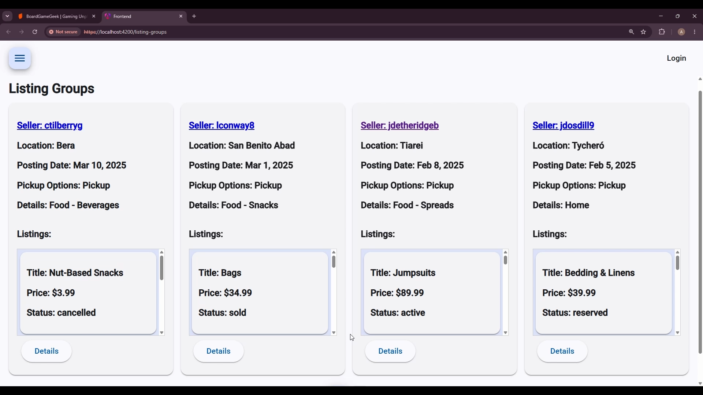

### Seller - create listing group
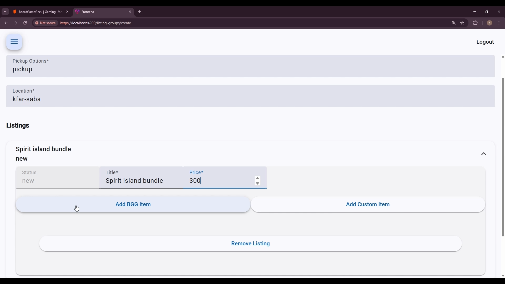

### Buyer - view listing group page with newly created listing group
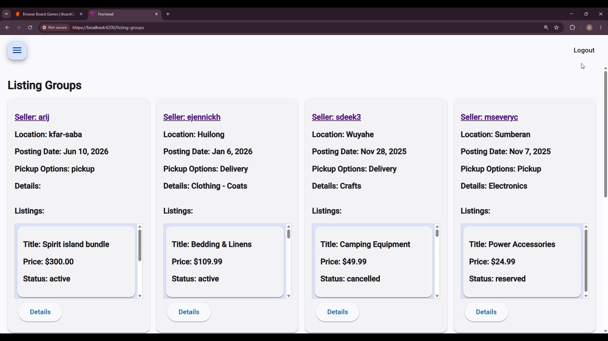

### Buyer - view listing group details
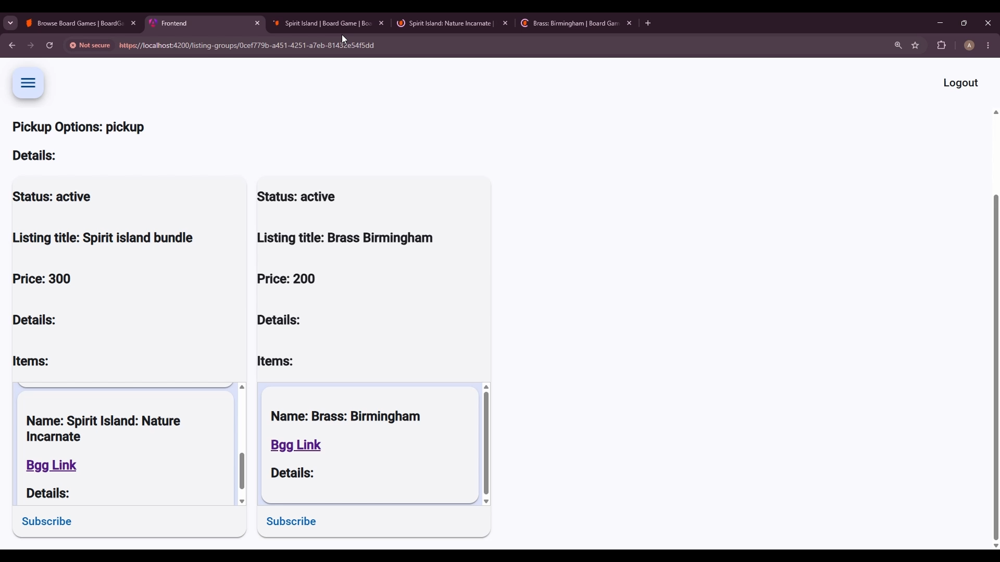

### Buyer - subscribes to listing
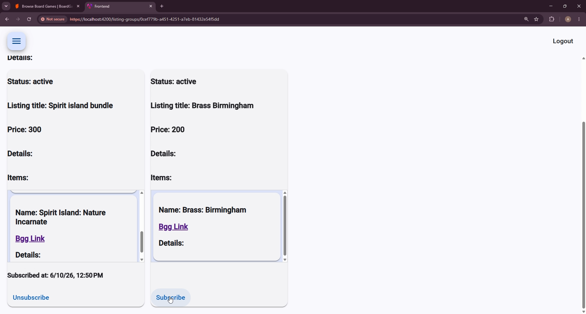

### Seller - manage listing queue
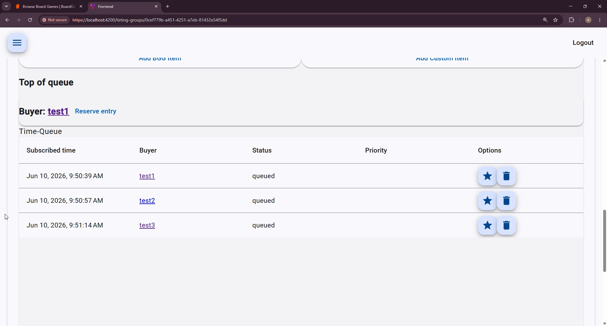

### Seller - update queue priority
In this example 2 queue entries (for users test2 and test3) were added to priority list and reordered so user test3 queue entry is at top priority despite being last in time based queue
If priority queue was empty, user test1 queue entry (first chronological entry) would've been assigned to top of queue
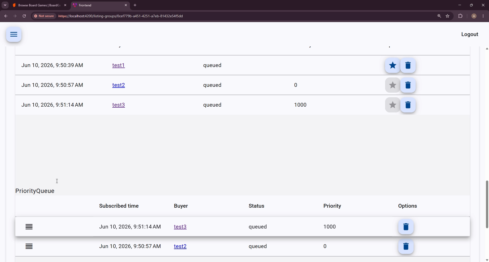

### Seller - listing view after reserving to top of queue
This is the listing view after reserving the listing to user test3
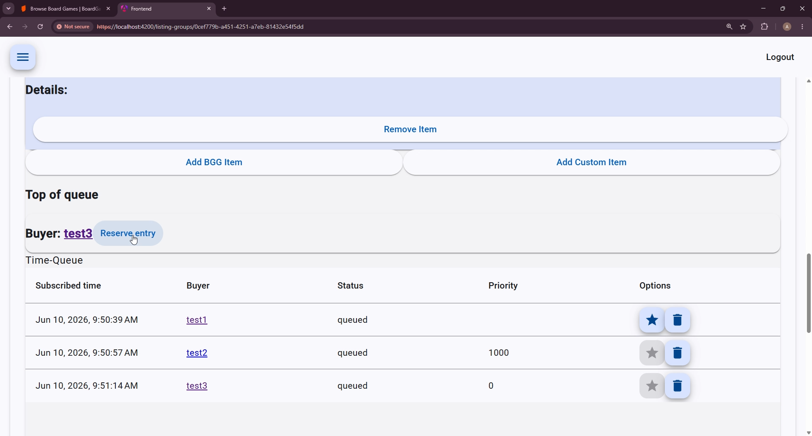

### Seller - view newly created reservation
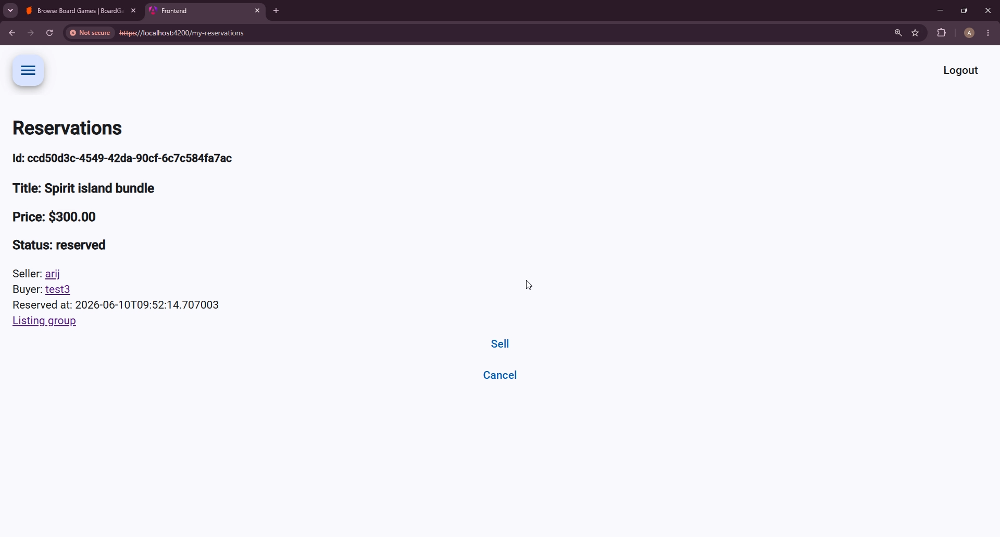

### Seller - view listing sold
This is the sell confirmation after confirming sell on the reservation
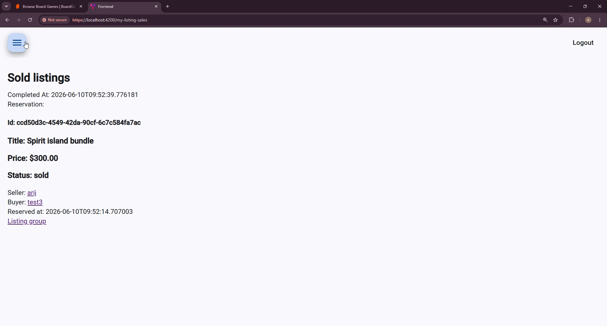

### Seller - my listings view
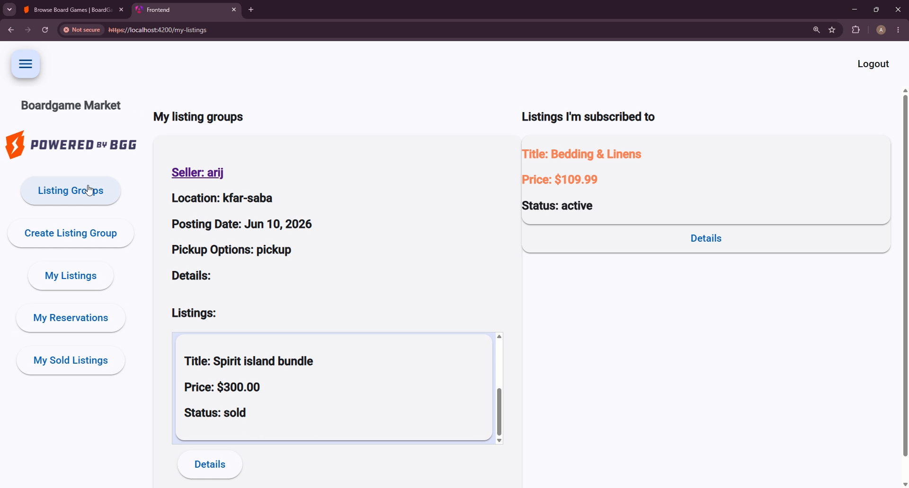