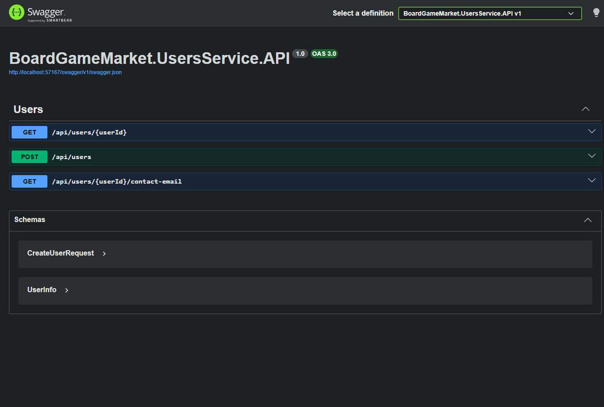
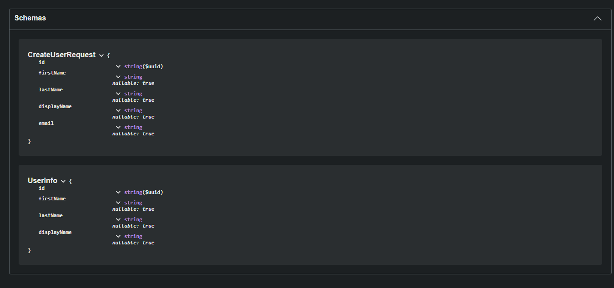
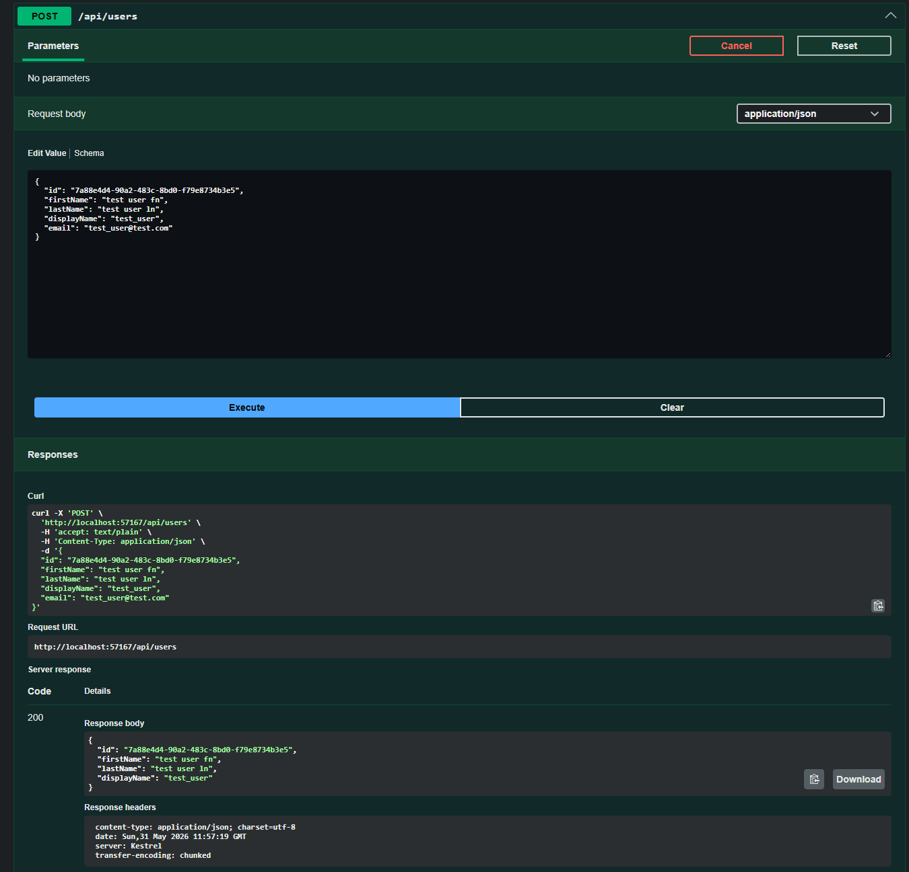
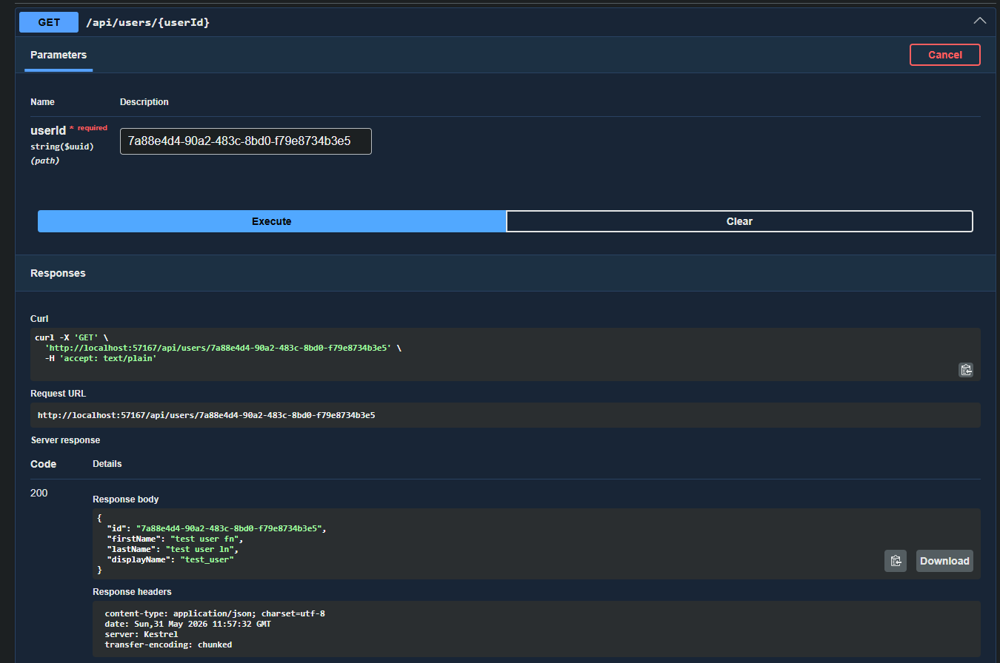
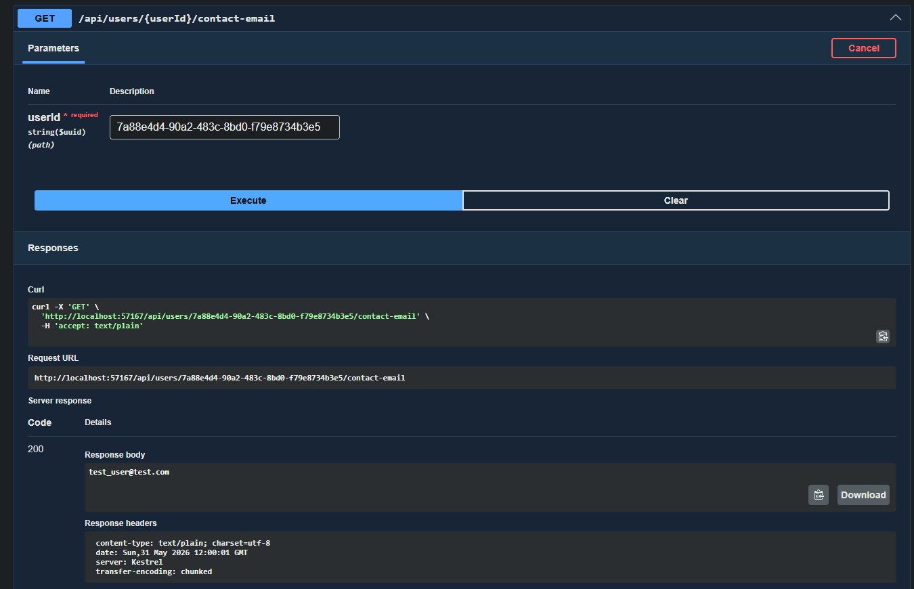

# Users Service

## Overview

The Users Service is a bounded-context microservice within the Boardgame Market distributed system.

It is responsible for:

- Storing in-system user details
- Serve as a projection of Entra ID data, so Entra is used mainly for authentication, to reduce external calls.

The service is designed to operate as part of a **gateway-orchestrated distributed system**, and is not intended for direct external access.

> NOTE:
> This repository is part of a snapshot-style public monorepo used for navigation and demonstration purposes.
> The primary development workflow for this service uses a separate private Azure DevOps repository with its own CI/CD pipeline.

---

## Responsibilities

This service owns the following domain concerns:

- Maintain internal ApplicationUser projections derived from Microsoft Entra ID
- Store and serve application-specific user data
- Support user creation based on authenticated identity context

It does NOT:

- Communicate directly with other services
- Expose cross-service contracts
- Handle cross-domain orchestration (handled by Gateway)

---

## Architecture

### Internal Structure

- Controllers / API layer
- Core Application layer which contains:
	- Domain layer
	- Data services and use cases
- Infrastructure layer

### Design Principles

- Clean separation of concerns
- Command / use-case driven business logic
- No direct service-to-service communication
- Stateless API design

---

## External Communication
This service does not directly integrate with Microsoft Entra ID.

Authentication is handled by the Market Gateway, which forwards authenticated identity context when creating or accessing users.

This service is accessed via:

- Market Gateway (primary entry point)
- Swagger and other API testing tools like Postman (development only)

---

## Persistence

Supported modes:


### Database-backed mode  
- PostgreSQL  
- Entity Framework Core  
- Full persistence support  
- Supports seeding with idempotency guarantees  
  
### In-memory mode  
- Used for local development and testing  
- No persistence guarantees  
- Supports seeding for development scenarios

---

## Seeding

Seeding behavior:

- Controlled via `IS_SEEDING`
- Requires `SEED_ROOT`

### Notes:

- Database-backed seeding uses idempotency checks to avoid duplicate inserts
- In-memory seeding is always re-initialized per application start

---

## Environment Variables

| Variable | Required | Description |
|----------|----------|-------------|
| `IN_MEMORY` | Yes | Enables in-memory mode |
| `IS_SEEDING` | Yes | Enables data seeding |
| `SEED_ROOT` | Conditional | Required when seeding is enabled |

---

### Database

| Variable | Required | Description |
|----------|----------|-------------|
| `POSTGRES_HOST` | Conditional | DB host |
| `POSTGRES_PORT` | Conditional | DB port |
| `POSTGRES_DATABASE` | Conditional | Database name |
| `POSTGRES_USER` | Conditional | Username |
| `POSTGRES_PASSWORD` | Conditional | Password |

---


## Runtime Modes

### Full System Mode
- Requires PostgreSQL
- Runs within Docker Compose or Kubernetes

### Local Development Mode
- Supports in-memory execution
- Limited external integration

---

## API Documentation

- Swagger available at:
  - `/swagger` (local only)

All endpoints are intended to be consumed via the Gateway in production-like environments.

---

## Dependencies

### Internal

- None (services do not communicate directly)

### External

- None

### Infrastructure Dependencies
- PostgreSQL (when using database-backed mode)
---

## Key Design Decisions

- No event-driven messaging (synchronous architecture)
- No service-to-service communication (gateway-only orchestration)

---

## Limitations

- Not intended for standalone production use
- Requires full system context for real workflows

---

## Testing

- Unit tests: xUnit
- Manual testing: Swagger / Postman / Gateway flows

---

## Docker

### Build

```bash
docker build -t arieljalkiver/boardgame-market:users -f ./BoardGameMarket.UsersService/src/BoardGameMarket.UsersService.API/Dockerfile ./BoardGameMarket.UsersService
```

## Swagger screenshots
### Endpoints and schema


<br/>

### Schemas


<br/>

### POST - register entra user


### GET - retrieve user


<br/>

### GET - email

