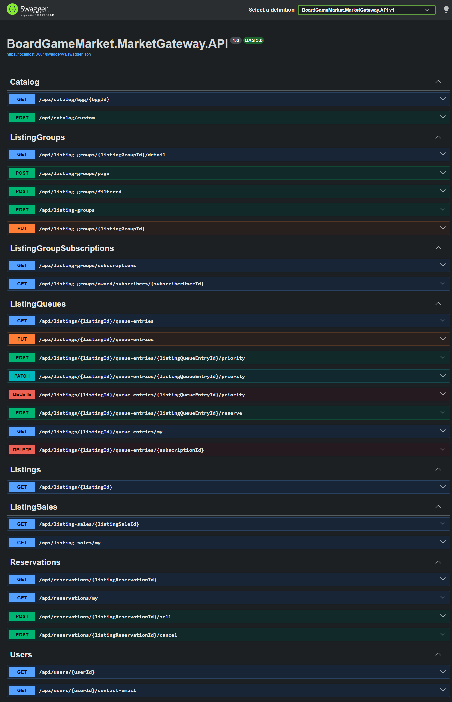
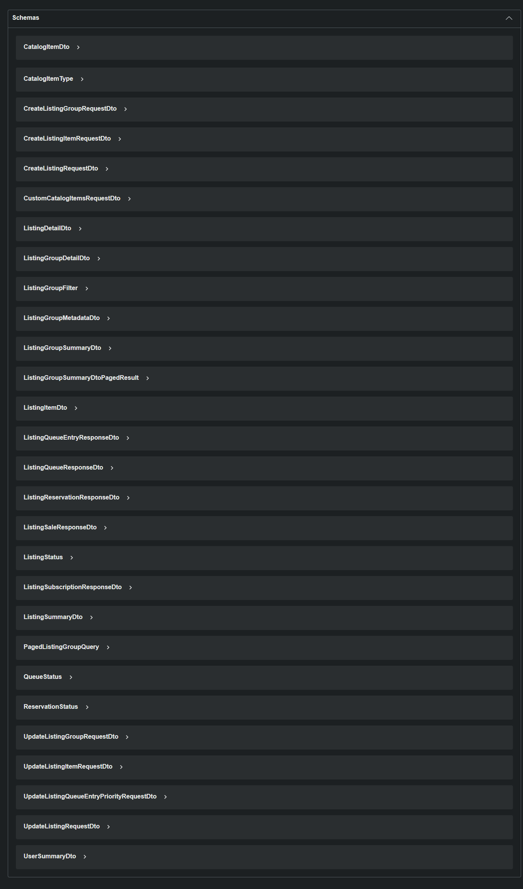
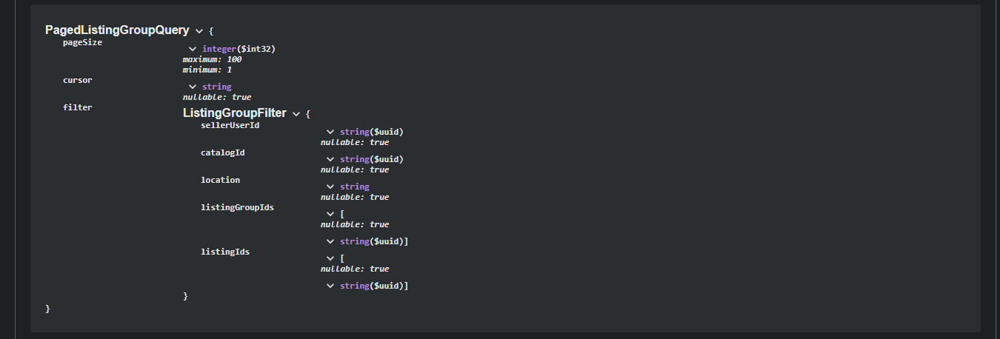
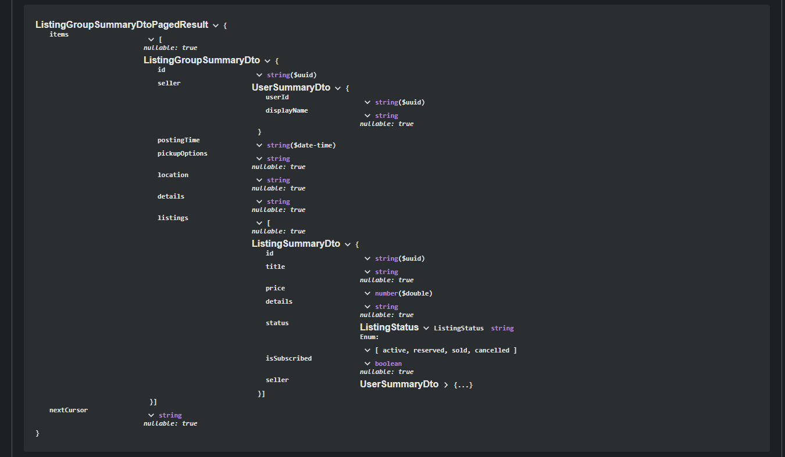
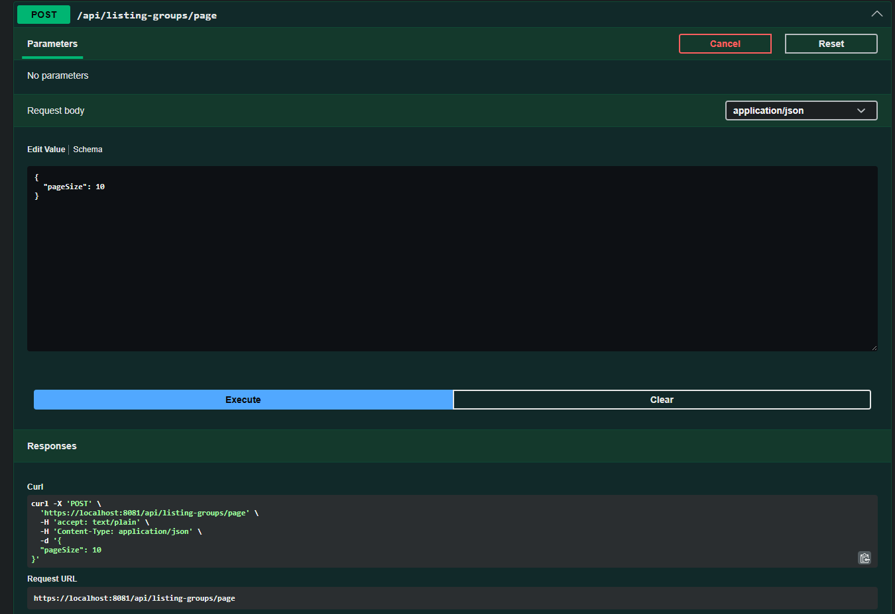
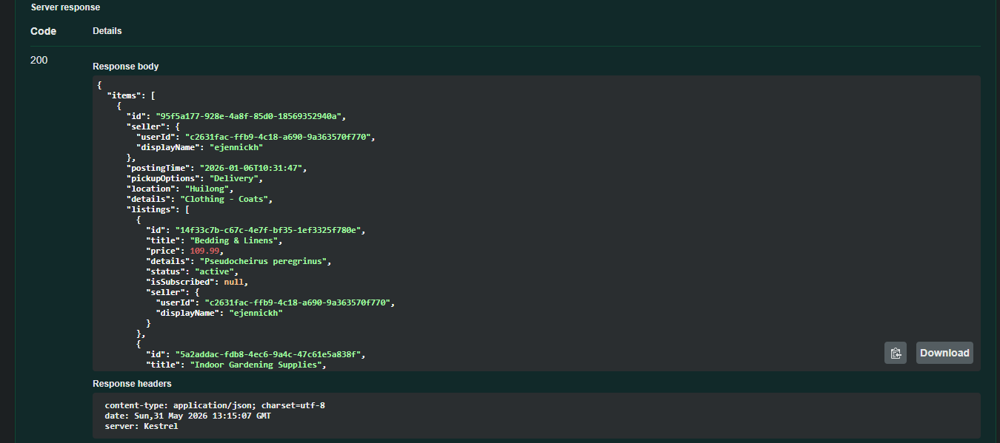
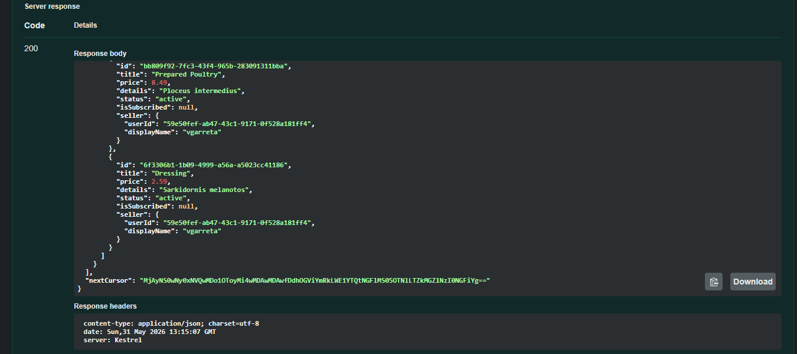
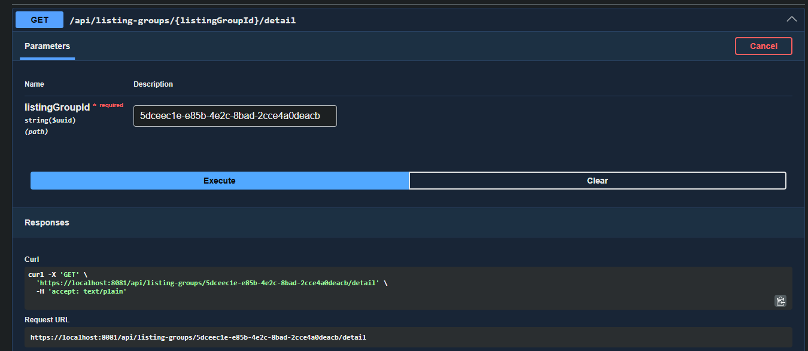
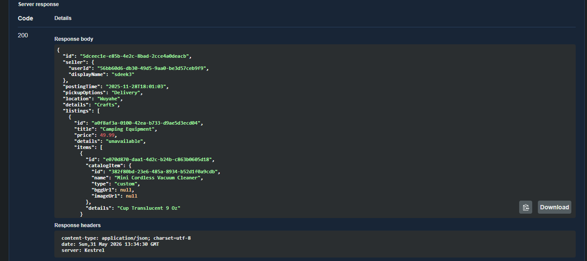
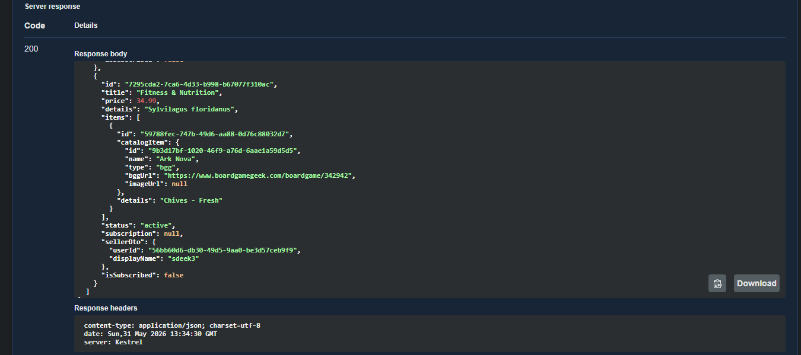

# Market Gateway

## Overview

The Market Gateway is a microservice within the Boardgame Market distributed system.  
It serves as the single entry point for the system.

It is responsible for:

- Orchestrating requests across internal services  
- Aggregating data into client-facing responses  
- Handling authentication and request context  
- Managing all external-facing concerns of the system  

> NOTE:

> This repository is part of a snapshot-style public monorepo used for navigation and demonstration purposes.

> The primary development workflow for this service uses a separate private Azure DevOps repository with its own CI/CD pipeline.
---

## Responsibilities

This service owns the following concerns:

- Expose a single API surface for all client interactions  
- Coordinate requests across Users, Catalog, and Listings services  
- Aggregate data from multiple services into unified responses  
- Enforce authentication and propagate identity context  

It does NOT:

- Contain domain/business logic for any bounded context  
- Communicate with external services outside the system boundary  
- Persist business data  

---

## Architecture

### Internal Structure

- Controllers / API layer  
- Application layer:
  - Domain-oriented client communication services (per downstream service)

---

### Design Principles

- Clean separation of concerns  
- Stateless API design  
- Gateway acts as orchestration layer, not a domain owner  
- No persistence responsibility  

---

## External Communication

This service is accessed via:

- Swagger / Postman or other API testing tools  
- Frontend (Angular implementation included in the project)  

---

## Caching

Redis is used to cache complex aggregated responses to reduce internal service calls and computation.

---

## Environment Variables

### Service Discovery

| Variable | Required | Description |
|----------|----------|-------------|
| `LISTINGS_SERVICE_HOST` | Yes | Listings service endpoint |
| `LISTINGS_SERVICE_PORT` | Yes | Listings service port |
| `CATALOG_SERVICE_HOST` | Yes | Catalog service endpoint |
| `CATALOG_SERVICE_PORT` | Yes | Catalog service port |
| `USERS_SERVICE_HOST` | Yes | Users service endpoint |
| `USERS_SERVICE_PORT` | Yes | Users service port |

---

### Redis

| Variable | Required | Description |
|----------|----------|-------------|
| `REDIS_HOST` | Yes | Redis host |
| `REDIS_PORT` | Yes | Redis port |

---

### CORS

| Variable | Required | Description |
|----------|----------|-------------|
| `CORS__ALLOWEDORIGINS` | Optional | Allowed frontend origins |

---

## Runtime Modes

All runtime modes require an Entra ID tenant and application registration for authentication workflows.

### Docker Compose

- Requires pre-built service images (use `build-for-compose.bat`)

---

### Full System Mode (Docker / Kubernetes)

- Requires full system deployment (use `deploy.bat`)
- Includes all internal services and infrastructure components  

---

### Local Development Mode (IDE)

- Requires Redis  
- Requires locally running internal microservices  
- Intended for isolated gateway development and debugging  

---

## API Documentation

- Swagger available at:  
  - `/swagger` (local only)

All endpoints are intended to be consumed through the client application.

---

## Dependencies

### Internal Services

- Users Service  
- Catalog Service  
- Listings Service  

### Infrastructure Dependencies

- Redis (caching layer)

---

## Key Design Decisions

- No event-driven messaging (synchronous architecture)  
- Gateway acts strictly as orchestration and aggregation layer  
- Avoided unnecessary distributed infrastructure complexity (e.g., message brokers, large-scale retry systems)  

---

## Limitations

- Requires full system context for meaningful execution  
- Requires Entra ID for all authenticated workflows  
- Does not contain business logic itself (delegates to downstream services)  

---

## Testing

- Manual testing: Swagger / Postman / Frontend client  

---

## Docker

### Build

docker build -t arieljalkiver/boardgame-market:gateway -f ./BoardGameMarket.MarketGateway/src/BoardGameMarket.MarketGateway.API/Dockerfile ./BoardGameMarket.MarketGateway

## Swagger screenshots
### All endpoints

---

### All scehams

---

### Listing group schemas
Listing Group Paged Query

 

 

Listing Group Paged Result

 

---

### Endpoints examples
#### Listing groups Page
Page input

 

 

Page response

 

---

#### Listing group details
Details input

 

Page response

 

