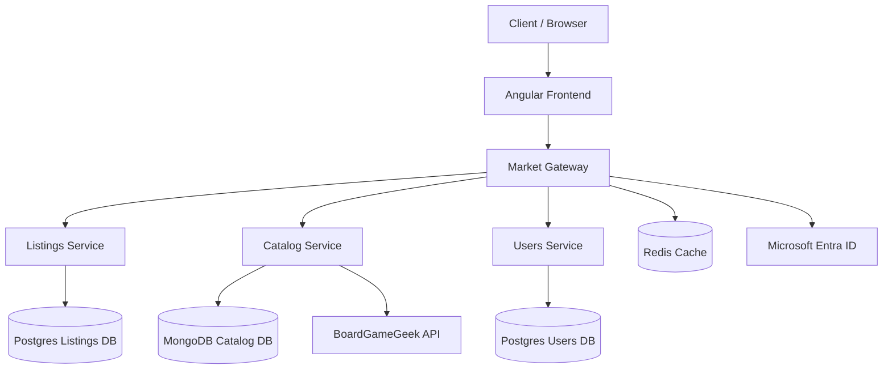
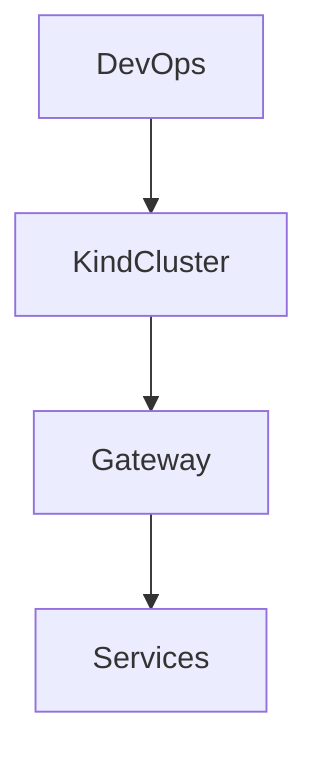
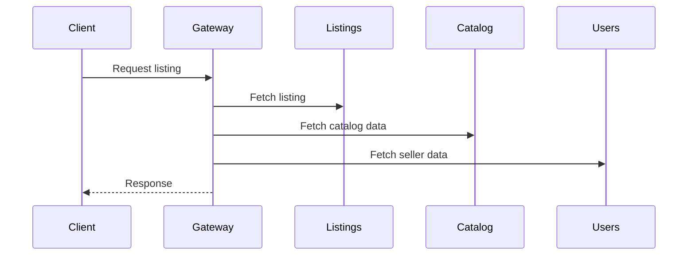

# Boardgame Market  
  
## Overview  
  
Boardgame Market is a second-hand marketplace platform for board-game related items, developed as a distributed system using ASP.NET Core microservices.  
  
The project was created as a personal project, to design and implement a complete end-to-end distributed backend system with realistic workflows, infrastructure, and deployment orchestration. 
  
> NOTE:  
> This repository is a snapshot-style monorepo for navigation and demonstration purposes.  
> The actual development workflow uses separate private Azure DevOps repositories per service with CI/CD pipelines.  
> Commits here represent periodic system snapshots rather than the primary version control history.  
  
---  
  
## Goals  
  
- Apply backend development concepts in a realistic distributed system  
- Gain hands-on experience with independently deployable services and orchestration  
- Build a marketplace tailored to board-game community needs  
- Design a fairness-oriented workflow instead of simple first-come-first-served logic  
  
---  
  
## Workflows  
  
- Sellers create **Listing Groups** representing a complete sale.  
- Each group contains one or more listings (single items or bundles).  
- Listings can reference BoardGameGeek items or custom entries.  
- Buyers subscribe to listings and are managed via two seller-only queues:  
	- Chronological subscription queue  
	- Manual priority queue  
- Queue state is private to sellers.  
- Listings can transition into reserved state during negotiation and later be sold or reactivated.  
  
---  
  
## Architecture  
  
The system consists of four microservices and supporting infrastructure.  
  
Each service defines its own configuration (environment variables, feature flags, external dependencies).  
Deployment layers only inject configuration via Compose, Kubernetes, or CI/CD.  
  
Service configuration is documented per repository:  
  
- Users Service → `BoardGameMarket.UsersService/`  
- Catalog Service → `BoardGameMarket.CatalogService/`  
- Listings Service → `BoardGameMarket.ListingsService/`  
- Gateway → `BoardGameMarket.MarketGateway/`  
- Infrastructure / Platform Layer → `BoardGameMarket.Infrastructure/`
  
### Core Services  
  
Services are fully isolated and do not communicate directly.  
All orchestration is handled via the gateway.  
  
- **Users Service**  
	- Internal user projections based on Microsoft Entra ID  
	- Extensible user data model  
  
- **Catalog Service**  
	- Board-game catalog management  
	- Integration with BoardGameGeek API for metadata caching  
  
- **Listings Service**  
	- Listing lifecycle, subscriptions, reservations, and sales  
	- Core business logic of the system  
  
### Gateway  
  
- Single external entry point  
- Authentication and authorization boundary  
- Orchestrates operations across services
- Aggregates backend services into unified responses  

### Infrastructure deployment
The Infrastructure layer is deployed via CI/CD to provision Kubernetes namespaces and required databases.
  
### API Testing  
  
- All services expose Swagger/OpenAPI  
- Angular frontend included for end-to-end validation  
  
### Backend Stack  
  
- ASP.NET Core  
- PostgreSQL, MongoDB  
- Redis  
- Microsoft Entra ID  
- Docker, Kubernetes (kind), Azure DevOps CI/CD  
- Entity Framework Core, Dapper  
- xUnit  
  
---

## Diagrams

### High Level

### CI/CD Deployment

### Core request flow

---

## Deployment  
  
The system supports two deployment modes.  
  
### 1. Docker Compose (Local Development)  
  
Purpose:  
- Fast iteration and debugging  
- Lightweight full-system execution  
  
Image naming:  
- `arieljalkiver/boardgame-market:<service>`  
  
Compose relies on images built via:  
- `build-for-compose.bat`  
  
---  
  
### 2. Kubernetes (kind)  
  
Purpose:  
- Infrastructure and orchestration testing  
- CI/CD simulation  
- Production-like deployment model  
  
Image naming:  
- `boardgamemarket-<service>:<build-tag>`  
  
Deployment methods:  
- Manual locally: `deploy-local-kind.bat`  
- CI/CD: End-to-end deployment simulation using a remote host machine and Azure DevOps pipelines (`azure-deploy-kind-pipeline.yaml`), emulating a production Kubernetes environment
  
---  
  
## Deployment Requirements  
  
### Microsoft Entra ID  
  
- Public browsing does not require authentication  
- Buying/selling requires authenticated users  
- Gateway validates identity for internal services  
  
A configured Entra tenant is required for full functionality.  
  
### BoardGameGeek API  
  
- Used for catalog enrichment  
- Optional mock client available if no API token is provided  
  
---  
  
## Project Management  
  
Azure DevOps Boards were used for:  
  
- Task tracking across services  
- Feature prioritization  
- Implementation planning  
- Scope control  
  
---  
  
## Possible Improvements  
  
### Listing Group deletion  
  
Edge case: empty listing groups are currently disallowed.  
  
Fix required:  
- Adjust lifecycle logic  
- Add group deletion endpoint  
  
Deferred due to low priority.  
  
### Game search  
  
- Search listings by game title or BGG ID  
- Deferred due to full vertical slice requirements  
  
### Messaging service  
  
- In-app buyer/seller messaging  
- Would require new service + communication model  
- Deferred in favor of email-based communication  
  
---  
  
## Discarded Features  
  
### Resilience patterns  
  
The system currently behaves closer to a distributed monolith than fully independent microservices.  
  
Adding retries/circuit breakers (e.g. Polly) was intentionally avoided due to limited benefit at current scale.  
  
### Message broker  
  
RabbitMQ was excluded because:  
  
- All communication flows through the gateway  
- No event-driven workflows exist  
- No service-to-service async requirements exist  
  
System remains intentionally synchronous.  
  
---  
  
## Image Naming Strategy  
  
### Docker Compose / Docker Hub  
  
- `arieljalkiver/boardgame-market:<service>`  
  
Used for local development and shared image storage.  
  
### Kubernetes (local + CI/CD)  
  
- `boardgamemarket-<service>:<build-tag>`  
  
Used for CI/CD and cluster clarity.  
  
This separation allows:  
  
- Simple local development  
- Clean CI/CD artifact tracking  
- No dependency on a single naming scheme  
  
---  

## What I Learned

- Learned the importance of building fast vertical slices instead of over-planning layered architecture upfront. Real end-to-end system usage exposes integration gaps and redundant abstractions earlier than API-only validation.
- The system was initially developed in a bottom-up manner, starting from backend domain services. Introducing a real client-facing flow later in development revealed missing and unnecessary functionality that was not apparent through API-level testing (e.g. Swagger/Postman), reinforcing the importance of validating system design through full end-to-end workflows early.
- Contracts should not be shared across different bounded contexts, even when doing so initially feels convenient.
- System and internal architectural boundaries matter more than they initially appear. Clear ownership and responsibility reduce long-term complexity significantly.
- Not every distributed system benefits from additional infrastructure patterns. Avoiding unnecessary complexity was often the better architectural decision.
- Commands/use-cases are extremely effective for containing complex behavior cleanly without leaking responsibilities across services or layers, helping keep services focused and maintainable.

---
  
## Quick Start  
   > NOTE:
  > Refer to CONFIGURATION.md for specific configuration details.
  
### Docker Compose  
- Run services via `docker-compose`  
- Run `build-for-compose.bat` if images are not available  
- Access:  
	- Gateway Swagger: http://localhost:8080/swagger  
  
### Kubernetes (kind)  

- Install kind  
- Run `deploy-local-kind.bat`  
- Access:  
	- Swagger: http://localhost:30080/swagger  
	- Or Angular frontend (see frontend documentation in `BoardGameMarket.Frontend/`)